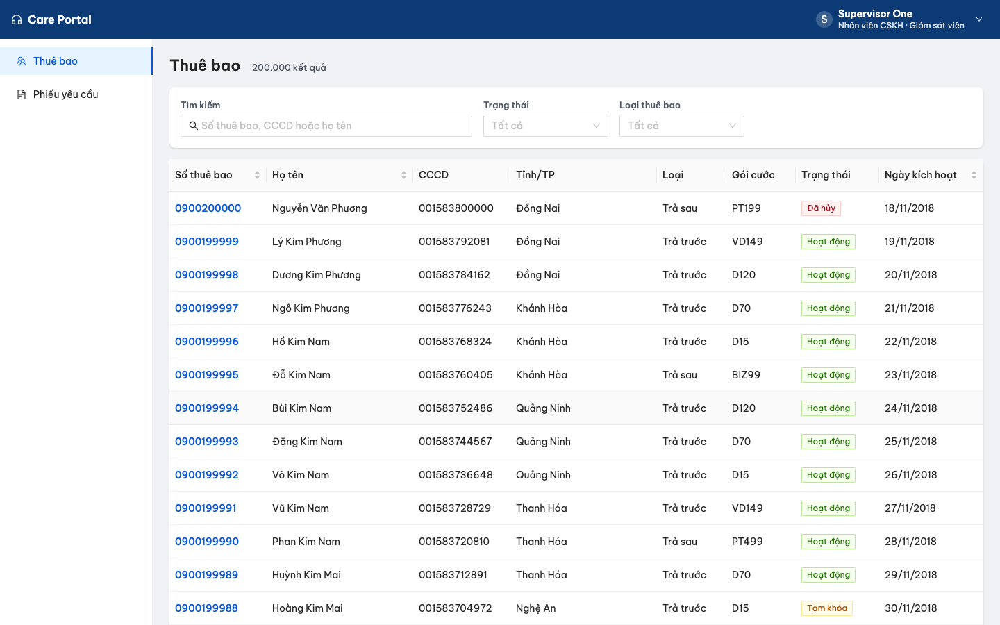
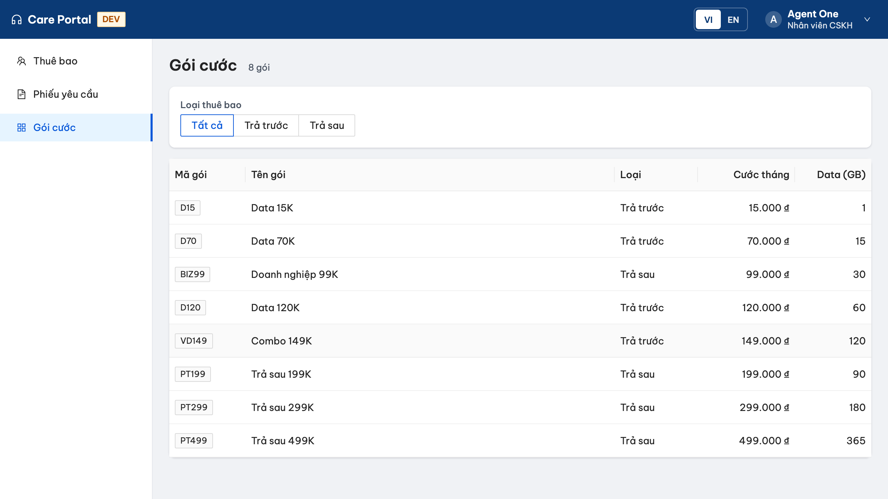

<!-- _class: lead -->
<!-- _paginate: false -->

# Buổi 1
## Kiến trúc Angular cho dự án lớn

Angular 22 · Nx 24 · ng-zorro · Spring Boot 3.5

---

## Mục tiêu buổi học

Sau buổi này, học viên có thể:

1. Giải thích **Clean Architecture** và chiều phụ thuộc; chia domain, application, data access, UI ở mức vừa đủ
2. Đặt **feature boundary**: lib, tag, public API, lazy route, phạm vi DI
3. Tách màn hình gọi API trực tiếp thành **port + adapter**, thay bằng fake để test độc lập
4. Biến quy tắc kiến trúc thành **luật import chạy trên CI**
5. Ghi quyết định bằng **ADR**; biết khi nào cần monorepo, khi nào tách thư viện

<p class="small">Sản phẩm đầu ra: sơ đồ phụ thuộc · ADR kiến trúc · quy tắc kiểm tra import trên CI</p>

---

## Lịch buổi học (4 giờ)

| Thời gian | Hoạt động |
|---|---|
| 20' | Giới thiệu khóa, dự án, phân tích use case |
| 40' | Khái niệm gắn với code: monorepo, lib, Clean Architecture, DI |
| 30' | Live demo: phá luật phụ thuộc, đọc lỗi; màn hình gọi HTTP trực tiếp |
| 10' | Nghỉ |
| 120' | Lab 5 bài |
| 20' | Review chéo, chốt ADR |

---

## Dự án mẫu xuyên suốt khóa học: Care Portal

<div class="cols">
<div>

Cổng xử lý **yêu cầu dịch vụ** (đề cương gọi là Service Portal)

- **portal**: Agent tạo, xử lý phiếu yêu cầu; Manager (`supervisor1`) phê duyệt
- **admin**: quản trị, thống kê
- 200.000 thuê bao, 50.000 phiếu: đủ cho bài tìm kiếm, phân trang trên 100.000+ bản ghi
- Vai trò: AGENT, SUPERVISOR (= Manager), ADMIN
- Đăng nhập bằng JWT do backend phát; SSO Keycloak ở buổi 7

</div>
<div>



</div>
</div>

---

## Kiến trúc tổng thể

```
  Trình duyệt: portal :4200 / admin :4300  (Angular 22)   ← học viên code ở đây
     │
     │  1. POST /api/auth/login  → nhận JWT
     │  2. Authorization: Bearer <JWT>
     ▼
  ── docker compose up ───────────────────────────────────────────
     Spring Boot API :8081  ───►  PostgreSQL 16 :5433   Adminer :8088
                                  200k thuê bao, có sẵn từ dump
  ────────────────────────────────────────────────────────────────
```

Học viên chỉ cần **Node + Docker**. Mỗi buổi học sẽ đào sâu một phần trong sơ đồ này.

<p class="small">Các tình huống sẽ gặp trong khóa: phản hồi API sai thứ tự, token hết hạn đồng thời, sai quyền, xung đột cập nhật (409), lỗi triển khai.</p>

---

## Dự án "nhỏ" trở thành "lớn" khi nào?

| Dấu hiệu | Hệ quả nếu không có kiến trúc |
|---|---|
| Nhiều team cùng sửa một repo | Xung đột code, sửa chỗ này hỏng chỗ khác |
| Nhiều app dùng chung logic (auth, API, UI) | Copy-paste, mỗi app một phiên bản |
| Hàng trăm màn hình | Bundle phình to, tải trang chậm |
| CI chạy toàn bộ test mỗi lần commit | Pipeline 30–60 phút |
| Component gọi thẳng `HttpClient` | Không test được màn hình nếu không giả lập cả HTTP |
| Nhiều môi trường (DEV/TEST/UAT/PROD) | Mỗi môi trường build riêng → "chạy ở TEST, lỗi ở PROD" |

<div class="tip">Kiến trúc là đặt <b>ranh giới</b> để code tăng thêm mà độ phức tạp không tăng theo cấp số nhân.</div>

---

## Monorepo hay Polyrepo?

<div class="cols">
<div>

**Polyrepo**: mỗi app/lib một repo
- ✅ Độc lập hoàn toàn, phân quyền dễ
- ❌ Dùng chung code phải publish npm
- ❌ Đổi API → sửa N repo, N lần release
- ❌ Lệch phiên bản Angular giữa các repo

</div>
<div>

**Monorepo**: nhiều project, một repo
- ✅ Đổi code dùng chung + các nơi dùng trong **1 commit**
- ✅ Một phiên bản Angular/thư viện
- ✅ Refactor toàn cục an toàn
- ❌ Cần công cụ: chỉ build/test phần bị ảnh hưởng, chặn import lung tung

</div>
</div>

<div class="good">Monorepo không có nghĩa là một khối code lớn: bên trong vẫn chia module với ranh giới rõ ràng. Công cụ để làm việc đó là <b>Nx</b>.</div>

---

## Nx mang lại gì?

| Tính năng | Ý nghĩa |
|---|---|
| **Project graph** | Biết project nào phụ thuộc project nào (phân tích import) |
| **Affected** | `nx affected -t test`: chỉ chạy phần bị ảnh hưởng bởi thay đổi |
| **Cache** | Kết quả build/test được cache, chạy lại không đổi thì trả kết quả ngay |
| **Generators** | Tạo app/lib/component theo đúng quy ước của team |
| **Module boundaries** | Luật ESLint cấm import sai tầng |

```bash
npx nx graph                       # xem đồ thị
npx nx run-many -t lint test build # chạy cho mọi project
npx nx affected -t test            # chỉ project bị ảnh hưởng (buổi 9)
```

---

## Cấu trúc workspace Care Portal

```
frontend/
  apps/
    portal/                      ← "vỏ": routing, cấu hình, ghép các feature
    admin/
    portal-e2e/
  libs/
    shared/util-config           type:util          cấu hình runtime
    shared/data-access-auth      type:data-access   AuthService, interceptor, guard
    shared/feature-auth          type:feature       trang đăng nhập
    shared/data-access-api       type:data-access   API client, model
    shared/ui-layout             type:ui            Shell, trang 403/404
    portal/feature-subscribers   type:feature       màn hình thuê bao
    portal/feature-tickets       type:feature       màn hình phiếu
    admin/feature-dashboard      type:feature       thống kê
```

<div class="tip">App nên <b>mỏng</b>: gần như chỉ có routing và provider. Code nghiệp vụ nằm trong lib.</div>

---

## Đồ thị phụ thuộc (`nx graph`)

| Tầng | Project | Phụ thuộc vào |
|---|---|---|
| app | `portal` | feature-subscribers, feature-tickets, feature-auth, data-access-auth, ui-layout, util-config |
| app | `admin` | feature-dashboard, feature-auth, data-access-auth, ui-layout, util-config |
| feature | `portal-feature-subscribers` | data-access-api, data-access-auth |
| feature | `portal-feature-tickets` | data-access-api, data-access-auth |
| feature | `admin-feature-dashboard` | data-access-api |
| feature | `shared-feature-auth` | data-access-api, data-access-auth |
| data-access | `shared-data-access-api` / `-auth` | util-config |
| ui | `shared-ui-layout` | *(không phụ thuộc lib nào)* |
| util | `shared-util-config` | *(không phụ thuộc lib nào)* |

<div class="tip">Mọi mũi tên đều đi <b>xuống</b> tầng dưới, và <code>admin</code> không chạm tới lib nào của <code>portal</code>. Demo trực tiếp: <code>npx nx graph</code>.</div>

---

## 4 loại lib

| Loại | Chứa gì | Ví dụ trong dự án |
|---|---|---|
| **feature** | Màn hình, smart component, route của một nghiệp vụ | `feature-subscribers` |
| **ui** | Component trình bày, chỉ có `input()`/`output()`, không gọi API | `ui-layout` (Shell) |
| **data-access** | Service gọi API, state, interceptor | `data-access-api`, `data-access-auth` |
| **util** | Hàm thuần, type, hằng số, không phụ thuộc Angular | `util-config` |

Chiều phụ thuộc **chỉ đi xuống**:

```
app ──► feature ──► ui / data-access ──► util
```

<p class="small">Đây là điểm xuất phát. Trong lab, ta thêm tầng thứ 5 <code>type:domain</code> nằm giữa data-access và util.</p>

---

## Tags: hai chiều phân loại

Mỗi lib mang 2 tag trong `project.json`:

```json
{ "name": "portal-feature-subscribers",
  "tags": ["scope:portal", "type:feature"] }
```

- `type:*` → **tầng kiến trúc** (feature / ui / data-access / util)
- `scope:*` → **miền nghiệp vụ / app** (portal / admin / shared)

Quy ước đặt tên: `<scope>-<type>-<tên>` → import `@care/portal-feature-subscribers`

---

## Module boundaries: luật được máy kiểm tra

`eslint.config.mjs` (thư mục gốc):

```js
depConstraints: [
  { sourceTag: 'type:app',     onlyDependOnLibsWithTags: ['type:feature','type:ui','type:data-access','type:util'] },
  { sourceTag: 'type:feature', onlyDependOnLibsWithTags: ['type:ui','type:data-access','type:util'] },
  { sourceTag: 'type:ui',      onlyDependOnLibsWithTags: ['type:ui','type:util'] },
  { sourceTag: 'type:data-access', onlyDependOnLibsWithTags: ['type:data-access','type:util'] },
  { sourceTag: 'type:util',    onlyDependOnLibsWithTags: ['type:util'] },
  { sourceTag: 'scope:portal', onlyDependOnLibsWithTags: ['scope:portal','scope:shared'] },
  { sourceTag: 'scope:admin',  onlyDependOnLibsWithTags: ['scope:admin','scope:shared'] },
  { sourceTag: 'scope:shared', onlyDependOnLibsWithTags: ['scope:shared'] },
]
```

<div class="good">Code review bằng mắt sẽ có lúc sót, còn lint thì chạy ở mọi commit. Vi phạm luật thì CI báo đỏ.</div>

---

## Vi phạm thì sao? (lỗi thật từ dự án)

Feature import feature khác:

```
error  A project tagged with "type:feature" can only depend on libs tagged with
       "type:ui", "type:data-access", "type:util"   @nx/enforce-module-boundaries
```

Đi vòng qua public API bằng đường dẫn tương đối:

```ts
import { SubscriberListPage } from '../../../feature-subscribers/src/lib/...';
```
```
error  Projects cannot be imported by a relative or absolute path,
       and must begin with a npm scope              @nx/enforce-module-boundaries
```

<div class="tip"><code>index.ts</code> là <b>public API</b> của lib. Những gì không export ra ở đó là chi tiết nội bộ, lib được phép đổi mà không cần báo ai.</div>

---

## Lazy loading theo nghiệp vụ

`apps/portal/src/app/app.routes.ts`

```ts
export const appRoutes: Route[] = [
  { path: 'login', canActivate: [guestGuard],
    loadComponent: () => import('@care/shared-feature-auth').then((m) => m.LoginPage) },
  {
    path: '',
    canActivateChild: [authGuard],          // chưa đăng nhập → /login?returnUrl=...
    children: [
      { path: '', pathMatch: 'full', redirectTo: 'subscribers' },
      { path: 'subscribers',
        loadChildren: () => import('@care/portal-feature-subscribers').then((m) => m.subscriberRoutes) },
      { path: 'tickets',
        loadChildren: () => import('@care/portal-feature-tickets').then((m) => m.ticketRoutes) },
      { path: 'forbidden', component: ForbiddenPage },
      { path: '**', component: NotFoundPage },
    ],
  },
];
```

---

## Bằng chứng: output của `nx build portal`

```
Initial chunk files | Names                  |  Raw size | Estimated transfer size
styles-MURJOT2J.css | styles                 | 576.99 kB |                52.94 kB
                    | Initial total          |   1.29 MB |               233.45 kB

Lazy chunk files    | Names                  |  Raw size | Estimated transfer size
chunk-C6JmX3Gg.js   | subscriber-detail-page |  41.00 kB |                11.05 kB
chunk-slCUYiXN.js   | subscriber-list-page   |   7.23 kB |                 2.69 kB
chunk-B8En6oCa.js   | ticket-list-page       |   7.09 kB |                 2.59 kB
```

- Mỗi màn hình là **một chunk riêng**, chỉ tải khi người dùng vào màn hình đó
- Thêm 100 màn hình thì bundle ban đầu **không tăng**

<div class="bad">Initial bundle 1,29 MB, trong đó riêng CSS (toàn bộ ng-zorro) đã 577 kB → bài tập tối ưu ở <b>buổi 5</b>.</div>

---

## Cấu hình hiện đại: function thay cho NgModule

`apps/portal/src/app/app.config.ts`

```ts
export function appConfig(config: AppConfig): ApplicationConfig {
  return {
    providers: [
      provideBrowserGlobalErrorListeners(),
      provideAppConfig(config),
      provideHttpClient(withInterceptors([authInterceptor])),
      provideRouter(appRoutes, withComponentInputBinding()),
      provideAuth(),        // ← lib data-access-auth tự đóng gói
      provideUi(),          // ← lib ui-layout: i18n vi_VN, icon
    ],
  };
}
```

- Mỗi lib cung cấp một hàm `provideXxx()` → app chỉ việc **ghép** lại
- Standalone component, **zoneless**, signals là mặc định từ Angular 20+

---

## Clean Architecture: chiều phụ thuộc hướng vào nghiệp vụ

```
        ┌─────────────── UI (feature, ui) ───────────────┐
        │    ┌──────── application (use case) ───────┐    │
        │    │     ┌──── domain (model, port) ───┐    │    │
        │    │     │  TicketSummary, TicketPort  │    │    │
        │    │     └─────────────────────────────┘    │    │
        │    └────────────────────────────────────────┘    │
        └── data access (adapter: HttpTicketAdapter) ──────┘
```

- Vòng trong **không biết** vòng ngoài: domain không import Angular, HTTP, ng-zorro
- Adapter (vòng ngoài) **implement** hợp đồng do vòng trong định nghĩa → đảo chiều phụ thuộc
- Ai nối port với adapter? **Composition root**: route/app config

<div class="tip">"Mức phù hợp": không cần 4 lib cho mỗi màn hình. Tách port khi có lý do: cần test độc lập, nhiều nguồn dữ liệu, backend hay đổi.</div>

---

## Ánh xạ sang Nx: thêm tầng `type:domain`

| Vòng Clean Architecture | Ở Angular / Nx | Ví dụ sau lab |
|---|---|---|
| domain | lib `type:domain`: type + abstract class port, **không** import Angular | `portal-domain-tickets` |
| application | signal/computed trong feature, hoặc store (buổi 4) | `TicketListPage` (lọc, phân trang) |
| data access | lib `type:data-access`: adapter HTTP, interceptor | `portal-data-access-tickets` |
| UI | lib `type:feature` (màn hình), `type:ui` (component trình bày) | `feature-tickets`, `ui-layout` |

```
app ──► feature ──► ui / data-access ──► domain ──► util
```

---

## Phạm vi DI: provider đặt ở đâu thì sống ở đó

| Nơi khai báo | Phạm vi, vòng đời | Dùng khi |
|---|---|---|
| `@Injectable({ providedIn: 'root' })` | Một instance cho cả app | Service không trạng thái, `TicketApi`, `AuthService` |
| `providers` trong `app.config.ts` | Cả app, do app chọn cách cấu hình | `provideHttpClient`, `provideAuth()` |
| `providers` trên **route** | Injector riêng của route và con; tạo khi vào route lazy | Nối port với adapter cho một feature |
| `providers` trên **component** | Mỗi instance component một bản | State cục bộ của màn hình (buổi 4) |

```ts
// apps/portal/src/app/app.routes.ts (composition root)
{ path: 'tickets', providers: [provideHttpTicketPort()],
  loadChildren: () => import('@care/portal-feature-tickets').then((m) => m.ticketRoutes) }
```

<div class="tip">Feature chỉ <code>inject(TicketPort)</code>. Đổi sang fake: thay một dòng provider, không sửa màn hình.</div>

---

## Port và adapter trong code

<div class="cols">
<div>

```ts
// libs/portal/domain-tickets
export abstract class TicketPort {
  abstract search(
    query: TicketQuery,
    page: PageQuery,
  ): Observable<TicketPage>;
}
```

```ts
// libs/portal/feature-tickets
private readonly tickets = inject(TicketPort);
result = rxResource({
  params: () => ({ search: this.filters(), page: this.page() }),
  stream: ({ params }) =>
    this.tickets.search(params.search, params.page),
});
```

</div>
<div>

```ts
// libs/portal/data-access-tickets
@Injectable()
export class HttpTicketAdapter extends TicketPort {
  private readonly api = inject(TicketApi);
  search(query, page) {
    return this.api.search(query, page).pipe(
      map((res) => ({
        items: res.content.map(toSummary),
        total: res.totalElements,
      })));
  }
}
```

<p class="small">Abstract class vừa là kiểu vừa là DI token. Interface thì biến mất khi biên dịch, nên phải tạo thêm <code>InjectionToken</code>.</p>

</div>
</div>

---

## Fake adapter: test màn hình không cần HTTP

```ts
port = new InMemoryTicketAdapter().seed([
  aTicket({ code: 'TK-A', assignee: 'agent1' }),
  aTicket({ code: 'TK-B', assignee: 'agent2' }),
]);
TestBed.configureTestingModule({ imports: [TicketListPage], providers: [
  { provide: TicketPort, useValue: port },
  { provide: AuthService, useValue: { username: signal('agent1') } }, ...] });

checkbox('Chỉ phiếu của tôi').click();
expect(port.calls.at(-1)?.query.assignee).toBe('agent1');
expect(codes()).toEqual(['TK-A']);
```

- Test nói về **hành vi nghiệp vụ** (lọc theo người xử lý), không về URL hay JSON
- Adapter HTTP có test riêng: đúng URL, query param, chuyển `content/totalElements` → `items/total`
---

## Luật import trên CI

Ngoài tag, chặn luôn **package** và **tên export** cụ thể:

```js
{ sourceTag: 'type:feature', ..., bannedExternalImports: ['@angular/common/http'] },
{ sourceTag: 'type:domain', onlyDependOnLibsWithTags: ['type:domain','type:util'],
  bannedExternalImports: ['@angular/core*', '@angular/common*', 'ng-zorro-antd*'] },
// libs/portal/feature-tickets/eslint.config.mjs
'no-restricted-imports': ['error', { paths: [{ name: '@care/shared-data-access-api',
  importNames: ['TicketApi'], message: 'Inject TicketPort ... (ADR-0002)' }] }]
```

```yaml
# .github/workflows/ci.yml (GitLab: job tương tự trong .gitlab-ci.yml)
- run: npm ci
- run: npx nx run-many -t lint        # buổi 9: nx affected + test + build + budget
```

---

## Runtime config: build một lần, deploy nhiều nơi

<div class="cols">
<div>

**❌ `environment.ts`**
- Giá trị đóng cứng vào bundle lúc build
- DEV/TEST/PROD = 3 bản build khác nhau
- Bản đã test ≠ bản lên PROD

</div>
<div>

**✅ `config.json` đọc lúc khởi động**
- 1 bản build, đổi file config theo môi trường
- Đúng tinh thần "build once, deploy many"
- DevOps đổi URL mà không cần dev

</div>
</div>

```ts
// apps/portal/src/main.ts
loadAppConfig()                                   // fetch('/config.json')
  .then((config) => bootstrapApplication(App, appConfig(config)))
  .catch((err) => console.error(err));
```

---

## Runtime config trong code

`libs/shared/util-config/src/lib/app-config.ts`

```ts
export interface AppConfig {
  apiUrl: string;     // địa chỉ backend, đổi theo môi trường mà không cần build lại
}

export const APP_CONFIG = new InjectionToken<AppConfig>('APP_CONFIG');
```

Bất cứ đâu cần thì inject:

```ts
private readonly baseUrl = `${inject(APP_CONFIG).apiUrl}/api/subscribers`;
```

`apps/portal/public/config.json` → copy nguyên vào `dist/` khi build

---

## Generators: quy ước viết một lần, dùng mãi

`nx.json`

```json
"generators": {
  "@nx/angular:library": {
    "linter": "eslint", "unitTestRunner": "vitest-analog",
    "standalone": true, "skipModule": true, "prefix": "care", "style": "scss"
  },
  "@nx/angular:component": { "style": "scss", "changeDetection": "OnPush" }
}
```

```bash
npx nx g @nx/angular:library libs/portal/feature-service-plans \
  --name=portal-feature-service-plans --tags=scope:portal,type:feature
```

<div class="tip">Thiếu <code>--name</code> → project tên <code>feature-service-plans</code>, import <code>@care/feature-service-plans</code>, lệch quy ước.</div>

---

## Quyết định kiến trúc: ghi lại bằng ADR

**ADR (Architecture Decision Record)**: vài đoạn văn trả lời *bối cảnh, phương án, quyết định, hệ quả, cách kiểm chứng*.
Mẫu: `course/_templates/adr.md` · ADR của dự án: `docs/adr/`

Ví dụ thật từ dự án này, `docs/adr/0001`: **chọn thư viện UI**

| | PrimeNG 22 | ng-zorro-antd 22 |
|---|---|---|
| License | Thương mại (PrimeUI): miễn phí khi doanh thu < 1 triệu USD, < 5 dev | MIT |
| Hỗ trợ Angular 22 | Có | Có |
| Bảng/form doanh nghiệp | Mạnh | Mạnh |

→ Quyết định: **ng-zorro-antd**. Tổ chức lớn mà dùng PrimeNG thì phải mua license theo số dev.

<div class="tip">Trước khi chọn thư viện, luôn kiểm tra <b>license</b>, không chỉ kiểm tra tính năng. ADR tốt ghi luôn <b>cách giữ quyết định</b>: lint rule, test, gate trên CI.</div>

---

## Khi nào monorepo, khi nào tách thư viện?

| Tình huống | Lựa chọn |
|---|---|
| Vài app cùng team, cùng nhịp release, dùng chung auth/API/UI | **Monorepo + lib nội bộ** (dự án này) |
| Thư viện UI dùng cho nhiều dự án, nhiều team, release riêng | Tách repo, **publish npm** (Nexus nội bộ), semver |
| Một lib được 1 nơi dùng | Chưa cần tách lib, để thư mục trong feature |
| Nhiều team cần deploy độc lập | Cân nhắc micro-frontend (slide sau) |

<div class="tip">Tách thư viện ra repo riêng có chi phí: version, changelog, nâng cấp đồng bộ. Chỉ trả chi phí đó khi có người dùng ngoài repo.</div>

---

## Micro-frontend thì sao?

| Cần micro-frontend (Module Federation) khi | Chưa cần khi |
|---|---|
| Nhiều team **deploy độc lập**, lịch release khác nhau | Một team / vài team cùng nhịp release |
| Ghép app của nhiều đơn vị, công nghệ khác nhau | Cùng Angular, cùng repo |
| Cần cập nhật một phần mà không deploy lại toàn bộ | Lazy loading đã đủ nhanh |

Cái giá phải trả: phức tạp về phiên bản thư viện dùng chung, routing, auth, debug.

<div class="good">Bắt đầu bằng <b>monorepo + lib có ranh giới rõ</b>. Nếu ranh giới đã đúng thì sau này tách sang micro-frontend chỉ là đổi cách deploy.</div>

---

## Phía backend: cùng tư duy ranh giới

```
backend/src/main/java/com/careportal/api/
  config/       SecurityConfig, CORS, OpenAPI, cache
  common/       PageResponse, ProblemDetail (lỗi chuẩn RFC 9457)
  subscriber/   Entity, Repository, Service, Controller, DTO, Mapper
  ticket/
  plan/
```

Hợp đồng ổn định giữa FE và BE:

```json
// Phân trang
{ "content": [...], "page": 0, "size": 20, "totalElements": 200000, "totalPages": 10000 }
// Lỗi
{ "status": 409, "detail": "So thue bao 0812345678 da ton tai" }
```

Đóng gói theo **nghiệp vụ** (package-by-feature) thay vì chia theo controller/service/repository.

---

## Lab (120 phút)

| Bài | Nội dung | Thời gian |
|---|---|---|
| 1 | Khám phá workspace, **vẽ sơ đồ phụ thuộc** hiện tại | 15' |
| 2 | Thêm màn hình **Gói cước**: generator → page → lazy route → menu | 30' |
| 3 | Tách `TicketListPage`: **TicketPort** + **HttpTicketAdapter** | 40' |
| 4 | **Fake adapter**, test màn hình không cần HTTP | 20' |
| 5 | Luật import mới, phá luật, chạy gate như CI | 15' |
| Mở rộng | Nhãn môi trường từ `config.json` (làm ở nhà nếu chưa kịp) | |

Review chéo 20': mỗi nhóm trình bày sơ đồ phụ thuộc trước/sau và **ADR-0002**.
Đề bài: `course/session-01/lab/README.md`

---

## Kết quả mong đợi của Bài 2



---

## Bẫy hay gặp khi làm lab

```ts
// ❌ Bảng trống, KHÔNG có request nào
plans = rxResource({
  params: () => this.type() ?? undefined,     // undefined → resource "idle"
  stream: ({ params }) => this.api.list(params),
});

// ✅
plans = rxResource({
  params: () => ({ type: this.type() }),
  stream: ({ params }) => this.api.list(params.type ?? undefined),
});
```

Thêm 2 lưu ý:
- Đọc `value()` khi resource đang lỗi → **throw**. Luôn kiểm tra `hasValue()` trước.
- Dùng icon mới → phải đăng ký trong `provideUi()`, nếu không icon sẽ không hiện.

---

## Tổng kết

1. Dự án lớn cần **ranh giới**: apps mỏng, logic nằm trong libs, phụ thuộc hướng vào domain
2. **Loại lib × scope**: tag hóa và để ESLint kiểm tra; thêm `type:domain` khi cần port
3. **Public API** (`index.ts`): không import xuyên vào file nội bộ của lib khác
4. **Port + adapter + composition root**: UI test được với fake, đổi backend chỉ sửa adapter
5. **Lazy loading** theo nghiệp vụ, kiểm chứng bằng output build
6. Quyết định kiến trúc → **ADR**, giữ quyết định bằng **luật import trên CI**

**Buổi 2:** Component dùng lại và màn hình nghiệp vụ phức tạp: `ticket-row`, typed Reactive Forms, xử lý HTTP 409.
