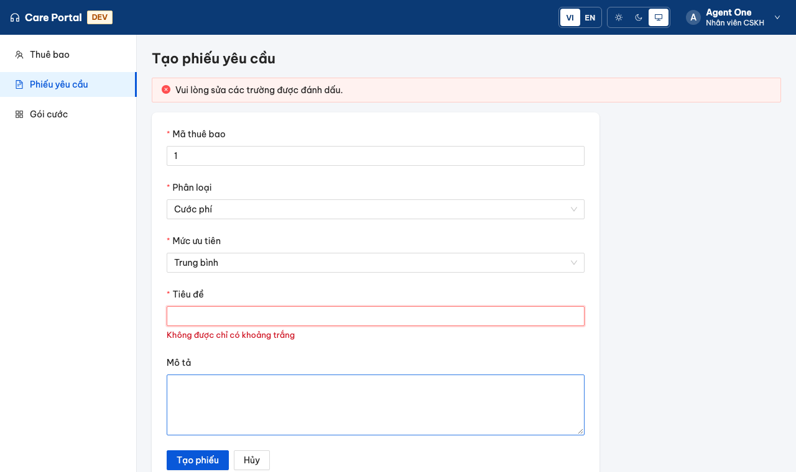
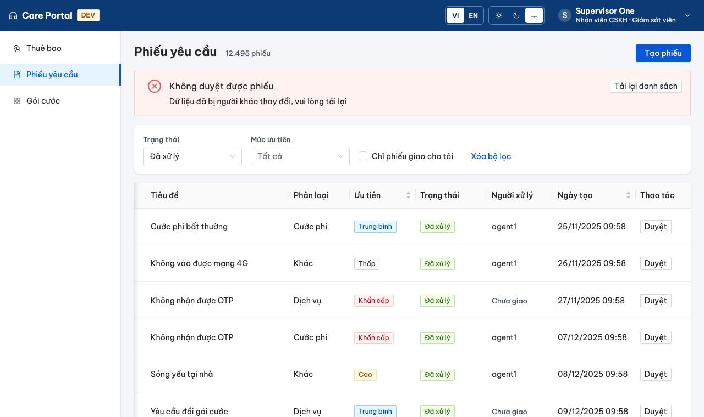
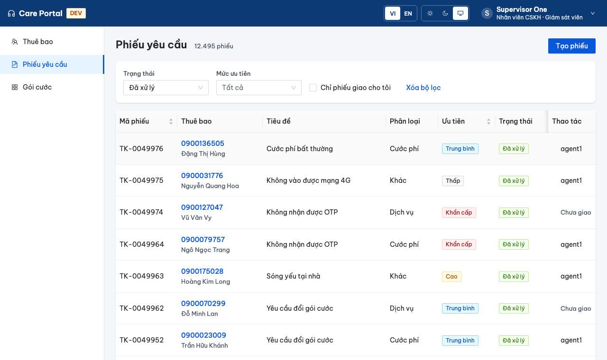

<!-- _class: lead -->
<!-- _paginate: false -->

# Buổi 2
## Component dùng lại và màn hình nghiệp vụ phức tạp

Hợp đồng component · Typed Reactive Forms · Lỗi API · HTTP 409 · Idempotency

---

## Mục tiêu buổi học

Sau buổi này, học viên có thể:

1. Thiết kế **hợp đồng component** bằng `input()`, `output()`; tách **container** với **component hiển thị**
2. Xây form bằng **typed Reactive Forms**, validator riêng, kiểm thử được
3. Quản lý **trạng thái gửi**, giữ dữ liệu khi lỗi, gắn **lỗi API** vào đúng trường
4. Làm form **accessible**: nhãn, `aria-invalid`, `aria-describedby`, focus, `aria-live`
5. Xử lý **xung đột cập nhật (HTTP 409)**; phân biệt **chống nhấp lặp** với **idempotency phía server**

<p class="small">Sản phẩm đầu ra: component có hợp đồng rõ · form có kiểm thử · xử lý HTTP 409</p>

---

## Lịch buổi học (4 giờ)

| Thời gian | Hoạt động |
|---|---|
| 20' | Review buổi 1 (ADR-0002, bài tập về nhà), phân tích use case |
| 40' | Hợp đồng component, typed forms, lỗi API, a11y, 409, idempotency |
| 30' | Live demo: hai Manager duyệt cùng một phiếu; double-click trên mạng chậm |
| 10' | Nghỉ |
| 120' | Lab 5 bài |
| 20' | Review chéo, chốt quyết định |

---

## Nhìn lại buổi 1 → câu hỏi mở cho hôm nay

- `TicketPort` chỉ có `search`. Hôm nay cần **tạo** và **duyệt** phiếu: thêm method vào port.
- Điểm bắt đầu `session02-start` đã có sẵn:

```ts
export abstract class TicketPort {
  abstract search(query: TicketQuery, page: PageQuery): Observable<TicketPage>;
  abstract create(command: CreateTicketCommand, idempotencyKey: string): Observable<TicketSummary>;
  abstract approve(id: number, version: number): Observable<TicketSummary>;
}
// Lỗi nghiệp vụ, không phải HttpErrorResponse:
export class TicketConflictError extends Error {}      // 409
export class TicketValidationError extends Error {     // 400
  constructor(message: string, readonly fieldErrors: Readonly<Record<string, string>>) { ... }
}
```

<div class="tip">Adapter HTTP chuyển 409/400 thành lỗi nghiệp vụ. Feature xử lý lỗi mà không biết mã HTTP hay JSON.</div>

---

## Use case hôm nay trên Care Portal

| # | Tình huống | Đang sai / thiếu |
|---|---|---|
| 1 | Dòng phiếu được viết thẳng trong template trang danh sách | Không dùng lại được, không test riêng được |
| 2 | Agent tạo phiếu, tiêu đề gõ `"     "` | `Validators.required` coi là hợp lệ |
| 3 | API lỗi khi gửi form | Người dùng phải nhập lại từ đầu |
| 4 | Hai Manager cùng duyệt một phiếu `version = 3` | Người sau ghi đè hoặc thấy lỗi khó hiểu |
| 5 | Bấm "Tạo phiếu" trên mạng chậm, timeout rồi gửi lại | Hai phiếu giống hệt nhau |

Vai trò: Agent = `agent1`, Manager = `supervisor1`. Manager duyệt phiếu **Đã xử lý** → **Đã đóng**.

---

## Container và component hiển thị

<div class="cols">
<div>

**Container** (lib `type:feature`)
- Inject service, port, router
- Biết ai đang đăng nhập
- Giữ state, gọi API, xử lý lỗi
- Ví dụ: `TicketListPage`

</div>
<div>

**Component hiển thị** (lib `type:ui`)
- Chỉ `input()` vào, `output()` ra
- Không inject service
- Không biết dữ liệu đến từ đâu
- Ví dụ: `TicketRow`

</div>
</div>

```
TicketListPage ──[ticket, canApprove, approving]──► TicketRow
               ◄────────────(approve)──────────────
```

<div class="good">Container quyết định <code>canApprove</code> (vai trò + trạng thái). Component chỉ hiện hoặc ẩn nút.</div>

---

## Hợp đồng component: input và output

```ts
@Component({ selector: 'tr[care-ticket-row]', ... })
export class TicketRow {
  readonly ticket = input.required<TicketSummary>();   // thiếu → lỗi biên dịch ở nơi dùng
  readonly canApprove = input(false);                  // có giá trị mặc định
  readonly approving = input(false);
  readonly approve = output<TicketSummary>();          // phát sự kiện, không gọi API
}
```

| API | Khi nào dùng |
|---|---|
| `input.required<T>()` | Không có giá trị hợp lý mặc định |
| `input(default)` | Tùy chọn, có mặc định an toàn |
| `input(x, { transform })` | Chuẩn hóa đầu vào: `booleanAttribute`, `numberAttribute` |
| `output<T>()` | Báo sự kiện cho cha |
| `model<T>()` | Hai chiều thật sự cần thiết (ô nhập tùy biến) |

---

## Vì sao selector là `tr[care-ticket-row]`?

```html
<!-- ❌ element selector: DOM thành tbody > care-ticket-row > td  → bảng không hợp lệ -->
<care-ticket-row [ticket]="t" />

<!-- ✅ attribute selector: tbody > tr > td, trình đọc màn hình đọc đúng hàng/cột -->
<tr care-ticket-row [ticket]="t" [canApprove]="..." (approve)="approve($event)"></tr>
```

Lint của repo mặc định chỉ cho selector dạng element → lib `ui-tickets` cho phép thêm `attribute`:

```js
'@angular-eslint/component-selector': ['error',
  { type: ['element', 'attribute'], prefix: 'care', style: 'kebab-case' }]
```

---

## Lib ui cần kiểu `TicketSummary`: sửa luật?

```
error  A project tagged with "type:ui" can only depend on libs tagged with
       "type:ui", "type:util"                       @nx/enforce-module-boundaries
```

| Phương án | Nhận xét |
|---|---|
| Copy interface vào lib ui | Hai nguồn sự thật, lệch dần |
| Đưa model vào lib util | Domain bị kéo xuống util, mất ranh giới |
| **Cho `type:ui` → `type:domain`** | Domain là TypeScript thuần, không Angular, không HTTP: ui dùng **kiểu** an toàn |

<div class="tip">Sửa luật là quyết định kiến trúc: ghi lý do ngay cạnh luật (và ADR nếu có hệ quả lâu dài).</div>

---

## Test hợp đồng bằng host component

```ts
@Component({
  imports: [TicketRow],
  template: `<table><tbody>
    <tr care-ticket-row [ticket]="ticket()" [canApprove]="canApprove()"
        [approving]="approving()" (approve)="approved.push($event)"></tr>
  </tbody></table>`,
})
class Host { ticket = signal(aTicket({ code: 'TK-9', status: 'RESOLVED' }));
             canApprove = signal(false); approving = signal(false); approved: TicketSummary[] = []; }

it('chỉ hiện nút Duyệt khi canApprove; bấm thì phát approve', async () => {
  ...
  fixture.componentInstance.canApprove.set(true);
  await fixture.whenStable();
  button().click();
  expect(fixture.componentInstance.approved.map((t) => t.code)).toEqual(['TK-9']);
});
```

Test qua **DOM + output**, không gọi method nội bộ: đổi cách cài đặt mà test vẫn đúng.

---

## Typed Reactive Forms

```ts
protected readonly form = new FormGroup({
  subscriberId: new FormControl<number | null>(null, Validators.required),
  category: new FormControl<TicketCategory | null>(null, Validators.required),
  priority: new FormControl<TicketPriority>('MEDIUM', { nonNullable: true }),
  title: new FormControl('', {
    nonNullable: true,
    validators: [Validators.required, notBlank, Validators.maxLength(200)],
  }),
  description: new FormControl('', { nonNullable: true, validators: Validators.maxLength(4000) }),
});

const v = this.form.getRawValue();   // { subscriberId: number | null; category: ...; title: string; ... }
```

- `nonNullable: true` → `reset()` về giá trị ban đầu, kiểu không có `| null`
- `getRawValue()` lấy cả control đang disabled; `value` thì bỏ qua chúng
- Sai tên control (`form.controls.titel`) → **lỗi biên dịch**, không còn lỗi lúc chạy

---

## `required` không chặn được `"     "`

```ts
/** Chuỗi chỉ gồm khoảng trắng → { blank: true }. Chuỗi rỗng để required báo. */
export function notBlank(control: AbstractControl<string | null>): ValidationErrors | null {
  const value = control.value;
  if (typeof value !== 'string' || value.length === 0) return null;
  return value.trim().length === 0 ? { blank: true } : null;
}
```

```ts
it.each([['   ', { blank: true }], ['\t\n', { blank: true }], ['  a ', null], ['', null]])
  ('%j -> %j', (value, expected) => expect(notBlank(new FormControl(value))).toEqual(expected));
```

<div class="bad">Validation phía client là để <b>trải nghiệm</b>. Phía server (<code>@NotBlank</code>) mới bảo đảm <b>đúng</b>: request có thể đến từ curl, script, app khác.</div>

---

## Trạng thái gửi và giữ dữ liệu khi lỗi

```ts
protected readonly submitting = signal(false);
protected readonly submitError = signal<FieldError | null>(null);

protected submit(): void {
  if (this.submitting()) return;                       // đang gửi: bỏ qua lần bấm tiếp
  if (this.form.invalid) { this.form.markAllAsTouched(); this.focusFirstInvalid(); return; }
  this.submitting.set(true);
  this.tickets.create(command, this.idempotencyKey).pipe(takeUntilDestroyed(this.destroyRef))
    .subscribe({
      next: (t) => this.router.navigate(['/tickets'], { state: { created: t.code } }),
      error: (e) => {                                  // KHÔNG reset form
        this.submitting.set(false);
        if (e instanceof TicketValidationError) this.applyServerErrors(e.fieldErrors);
        ...
      },
    });
}
```

---

## Lỗi API gắn vào đúng trường

```json
// 400 từ backend (RFC 9457), detail đã dịch theo Accept-Language
{ "status": 400, "detail": "Dữ liệu không hợp lệ", "errors": { "title": "không được để trống" } }
```

```ts
private applyServerErrors(fieldErrors: Readonly<Record<string, string>>): void {
  for (const [field, message] of Object.entries(fieldErrors)) {
    const control = this.form.get(field);
    if (!control) continue;
    control.setErrors({ ...control.errors, server: message });
    control.markAsTouched();
  }
}
```

- Lỗi `server` **tự mất** khi người dùng sửa giá trị (validator chạy lại)
- Lỗi không gắn được vào trường nào → thông báo chung trên form

---

## Accessibility cho form

```html
<nz-form-label nzFor="tk-title" nzRequired>{{ 'ticket.form.title' | transloco }}</nz-form-label>
<input nz-input id="tk-title" formControlName="title"
       [attr.aria-invalid]="titleErr ? true : null"
       [attr.aria-describedby]="titleErr ? 'tk-title-error' : null" />
@if (titleErr) { <div class="field-error" id="tk-title-error">...</div> }

<div aria-live="assertive">@if (submitError(); as err) { <nz-alert role="alert" ... /> }</div>
```

| Yêu cầu | Cách làm |
|---|---|
| Nhãn đọc được | `for` / `id` |
| Biết trường nào lỗi, lỗi gì | `aria-invalid`, `aria-describedby` |
| Không phải đi tìm lỗi | Focus vào trường lỗi đầu tiên (`afterNextRender`) |
| Màu chữ lỗi đạt 4,5:1 | `--care-danger` (#cf1322 = 5,6:1). `#ff4d4f` của ng-zorro chỉ 3,3:1 |

---

## Kết quả: form khi tiêu đề chỉ có khoảng trắng



---

## Xung đột cập nhật: optimistic locking

```
Manager A                  API (Ticket @Version)                 Manager B
   │ GET  → version 3              │                                │ GET  → version 3
   │ POST /approve {version: 3} ──►│ 3 == 3 → CLOSED, version 4     │
   │◄──────────────── 200 ─────────│                                │
   │                               │◄── POST /approve {version: 3} ─│
   │                               │ 3 != 4 → 409 error.staleData   │
   │                               │──────────────── 409 ──────────►│
```

```java
if (ticket.getVersion() != version) throw new ConflictException("error.staleData");
if (ticket.getStatus() != TicketStatus.RESOLVED) throw new ConflictException("error.ticketNotResolved");
```

<div class="tip">Client gửi kèm <b>version nó đang nhìn thấy</b>. Không gửi version = "ghi đè mù" (last write wins).</div>

---

## 409 trên giao diện: không im lặng, không ghi đè

```ts
this.tickets.approve(ticket.id, ticket.version).pipe(finalize(() => this.approvingId.set(null)), ...)
  .subscribe({
    next: (t) => { this.notice.set({ key: 'ticket.approve.done', params: { code: t.code } }); this.result.reload(); },
    error: (e) => this.approveError.set(
      e instanceof TicketConflictError ? { text: e.message } : { key: 'common.genericError' }),
  });
```



Người dùng **chọn** tải lại. Không tự động gửi lại với version mới: Manager kia có thể đã có lý do.

---

## Chống nhấp lặp ≠ idempotency

| | Chống nhấp lặp (client) | Idempotency (server) |
|---|---|---|
| Cách làm | Disable nút, bỏ qua khi `submitting()`, `exhaustMap` | Header `Idempotency-Key`, server nhớ key → kết quả |
| Chặn được | Double-click trong cùng tab | Gửi lại sau timeout, retry tự động, proxy gửi lại, hai tab |
| Không chặn được | Request đã tới server nhưng response mất | (đúng thiết kế thì chặn được cả hai) |
| Ai chịu trách nhiệm | Frontend | Backend + frontend sinh key đúng |

<div class="bad">Timeout không có nghĩa là thất bại: request có thể đã tạo phiếu, chỉ có response bị mất.</div>

---

## Idempotency-Key: vòng đời của key

```ts
/** Một key cho một lần "tạo phiếu", KHÔNG phải cho mỗi lần bấm. */
private idempotencyKey = crypto.randomUUID();

this.tickets.create(command, this.idempotencyKey)    // gửi lại sau lỗi: CÙNG key
next: () => { this.idempotencyKey = crypto.randomUUID(); ... }   // thành công: key mới
```

```
POST /api/tickets  Idempotency-Key: 7f3c…   → 201  Idempotent-Replayed: false   (tạo TK-0050012)
POST /api/tickets  Idempotency-Key: 7f3c…   → 201  Idempotent-Replayed: true    (trả lại TK-0050012)
POST /api/tickets  Idempotency-Key: 7f3c…   (nội dung khác) → 409 error.idempotencyKeyReused
```

| Sinh key ở đâu | Hệ quả |
|---|---|
| Mỗi lần bấm gửi | Gửi lại sau timeout → **phiếu trùng** |
| Khi mở form | ✅ Thử lại an toàn; đổi key sau khi thành công |

---

## Backend đã chuẩn bị (học viên không sửa Java)

| Endpoint | Hành vi |
|---|---|
| `POST /api/tickets` | `@Valid` (`@NotBlank` title), header `Idempotency-Key` tùy chọn |
| `POST /api/tickets/{id}/approve` `{ version }` | `@PreAuthorize("hasRole('SUPERVISOR')")`; version cũ → 409; không phải RESOLVED → 409 |
| Lỗi | RFC 9457 `ProblemDetail`, `detail` dịch theo `Accept-Language`, `errors` theo trường |

```bash
# Agent gọi thẳng API duyệt → 403, dù UI đã ẩn nút
curl -X POST localhost:8081/api/tickets/123/approve -H "Authorization: Bearer $AGENT" \
  -H 'Content-Type: application/json' -d '{"version":0}'
```

<p class="small">Idempotency lưu trong bộ nhớ cho dễ đọc. Production: lưu DB/Redis để chạy nhiều instance và không mất khi khởi động lại.</p>

---

## Live demo (30 phút)

1. Hai cửa sổ ẩn danh, cùng đăng nhập `supervisor1`, lọc **Đã xử lý**. Cửa sổ A duyệt, cửa sổ B duyệt cùng dòng → 409. Mở tab Network đọc body.
2. DevTools → Network → **Slow 3G**. Bấm "Tạo phiếu" liên tục: chỉ một request.
3. Chuột phải request POST → **Replay XHR**: response header `Idempotent-Replayed: true`, cùng mã phiếu.
4. Đổi code về "mỗi lần bấm một key", Replay → mã phiếu mới: thấy lỗi phiếu trùng.

<div class="tip">Hỏi lớp trước mỗi bước: "Theo anh chị, chuyện gì sẽ xảy ra?"</div>

---

## Lab (120 phút)

| Bài | Nội dung | Thời gian |
|---|---|---|
| 1 | Trích `ticket-row` sang lib `portal-ui-tickets`, test hợp đồng | 30' |
| 2 | Trang tạo phiếu: typed form, validator `notBlank`, test | 35' |
| 3 | Trạng thái gửi, giữ form khi lỗi, lỗi server theo trường, focus | 25' |
| 4 | Manager duyệt phiếu, xử lý 409, tái hiện bằng 2 trình duyệt | 20' |
| 5 | Idempotency-Key: giữ key khi gửi lại, chứng minh bằng Network | 10' |

Điểm bắt đầu: `git checkout session02-start` · Đề bài: `course/session-02/lab/README.md`

---

## Kết quả mong đợi: danh sách cho Manager



---

## Bẫy hay gặp khi làm lab

| Hiện tượng | Nguyên nhân |
|---|---|
| Bảng vỡ cột, trình đọc màn hình đọc sai | Selector `care-ticket-row` dạng element trong `tbody` |
| Lint: `type:ui` không được phụ thuộc `type:domain` | Chưa cập nhật luật |
| Lỗi `server` không mất khi sửa | Gán lỗi bằng biến riêng thay vì `setErrors` trên control |
| Form trống sau khi API lỗi | Gọi `form.reset()` trong nhánh lỗi |
| Không đọc được `subscriberId` từ URL | Quên `input()` hoặc app chưa bật `withComponentInputBinding()` |
| Gửi lại sau timeout tạo 2 phiếu | Sinh `Idempotency-Key` trong `submit()` |
| Test báo `NG04002 Cannot match any routes` | Test gọi `router.navigate` thật: dùng `vi.spyOn(router, 'navigate')` |

---

## Tổng kết

1. **Container** quyết định, **component hiển thị** chỉ có `input`/`output`; test qua DOM và output
2. Selector thuộc tính cho dòng bảng; lib `ui` được dùng **kiểu** của domain
3. **Typed forms**: lỗi tên control lúc biên dịch; `notBlank` vì `required` không chặn khoảng trắng
4. Lỗi API: **giữ form**, gắn lỗi server vào đúng trường, focus lỗi đầu tiên, `aria-live`
5. **409**: gửi kèm version, báo rõ, để người dùng chọn tải lại
6. **Chống nhấp lặp** ở client không thay **idempotency** ở server; key sinh theo lần thao tác

**Buổi 3:** Signals và RxJS: truy vấn cũ trả về muộn, hủy request, luồng sống sau lỗi.
