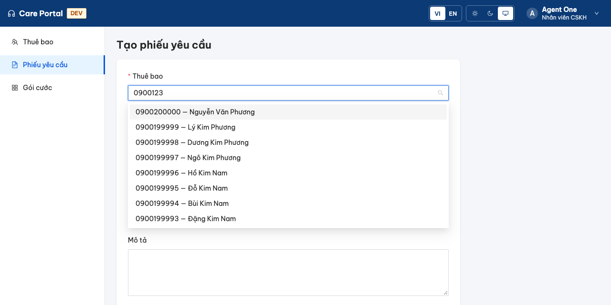
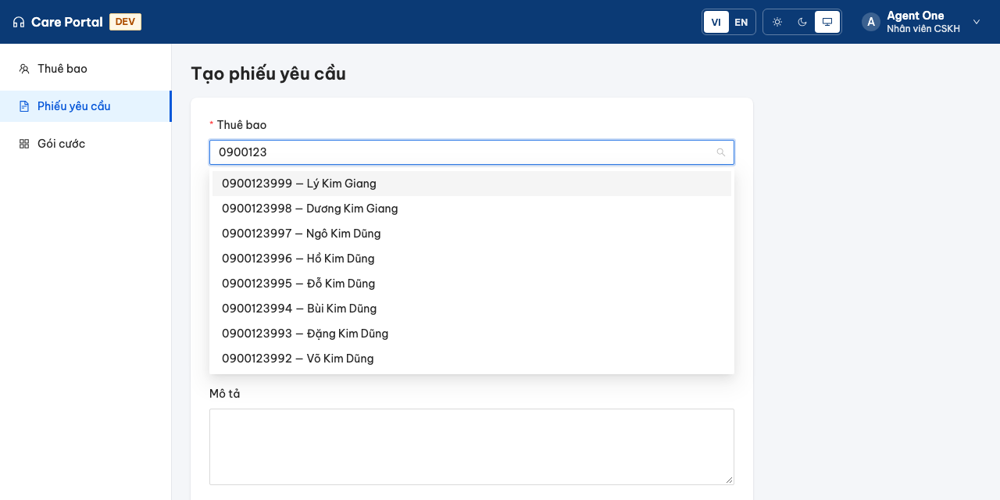

<!-- _class: lead -->
<!-- _paginate: false -->

# Buổi 3
## Signals và RxJS cho luồng dữ liệu

signal · computed · effect · interop · switchMap / concatMap / exhaustMap / mergeMap · teardown · lỗi trong luồng

---

## Mục tiêu buổi học

Sau buổi này, học viên có thể:

1. Chọn đúng công cụ: **signal** cho trạng thái, **Observable** cho sự kiện theo thời gian
2. Chuyển qua lại bằng `toSignal`, `toObservable`, `rxResource`; biết teardown của từng cách
3. Chọn operator làm phẳng theo ngữ nghĩa: `switchMap`, `concatMap`, `exhaustMap`, `mergeMap`
4. Giữ luồng **sống sau lỗi**; hiện trạng thái đang tải và lỗi ngay trong luồng
5. Viết **test theo trình tự sự kiện** bằng marble (`TestScheduler`) và kiểm tra subscription khi rời màn hình

<p class="small">Sản phẩm đầu ra: pipeline tìm kiếm có hủy · test theo trình tự sự kiện · bảng lựa chọn operator</p>

---

## Lịch buổi học (4 giờ)

| Thời gian | Hoạt động |
|---|---|
| 20' | Review buổi 2 (bài tập về nhà, 409, idempotency), phân tích use case |
| 40' | Signals, interop, marble, operator làm phẳng, lỗi, teardown, cache |
| 30' | Live demo: truy vấn cũ trả về muộn trên trình duyệt thật |
| 10' | Nghỉ |
| 120' | Lab 5 bài |
| 20' | Review chéo, chốt bảng chọn operator |

---

## Use case: ô chọn thuê bao có tìm kiếm

Buổi 2, form tạo phiếu bắt Agent gõ **mã thuê bao** (số id). Hôm nay thay bằng ô chọn có tìm kiếm:

- Gõ số thuê bao, CCCD hoặc tên, dừng gõ thì tìm, hiện tối đa 10 kết quả
- Trên 200.000 thuê bao: từ khóa ngắn (`0900`) khớp rất nhiều, **chậm**; từ khóa dài (`0900123`) **nhanh**

```html
<care-subscriber-picker inputId="tk-subscriber" formControlName="subscriberId" ... />
```

`SubscriberPicker` cài `ControlValueAccessor` nên form dùng như một ô nhập bình thường. Toàn bộ logic tìm kiếm nằm trong hàm `lookup()`.

<div class="tip">Điểm bắt đầu <code>session03-start</code> đã nối sẵn giao diện. Pipeline trong <code>lookup()</code> có <b>4 vấn đề cố ý</b>. Hôm nay tìm và sửa từng cái, có test chứng minh.</div>

---

## Điểm bắt đầu: đọc và đoán lỗi

```ts
export function lookup<T>(search: (term: string) => Observable<T[]>, debounceMs = 300) {
  return (terms: Observable<string>) => terms.pipe(
    debounceTime(debounceMs),
    mergeMap((term) => search(term).pipe(
      map((items): LookupState<T> => ({ status: 'done', term, items })),
    )),
    catchError(() => of({ status: 'error', term: '', items: [] })),
  );
}

// subscriber-picker.ts
constructor() {
  this.terms.pipe(lookup((term) => this.search(term)))
    .subscribe((state) => this.state.set(state));
}
```

<div class="tip">Trước khi xem slide sau: anh chị thấy những vấn đề gì? Ghi ra giấy.</div>

---

## Bốn vấn đề

| # | Code | Hậu quả |
|---|---|---|
| 1 | `mergeMap` | Request `0900` (chậm) về **sau** `0900123` (nhanh) → danh sách sai |
| 2 | Không `trim`, không `distinctUntilChanged`, không độ dài tối thiểu | Gọi API thừa; `"09"` quét cả bảng |
| 3 | `catchError` **ngoài** `mergeMap` | API lỗi một lần → luồng kết thúc, gõ tiếp không tìm nữa |
| 4 | `subscribe()` trong constructor, không hủy | Rời màn hình khi đang tìm: request vẫn chạy, callback vẫn ghi vào component đã hủy |

Thêm một thiếu sót về trải nghiệm: không có trạng thái **đang tìm**.

---

## Signal: bốn công cụ

| API | Dùng khi | Ví dụ trong Care Portal |
|---|---|---|
| `signal(v)` | Trạng thái gốc, có người ghi | `status`, `priority`, `onlyMine` ở trang phiếu |
| `computed(() => ...)` | Giá trị suy ra, chỉ đọc, tự cập nhật | `filters`, `rows`, `isManager` |
| `linkedSignal({ source, computation })` | Suy ra nhưng **vẫn ghi đè được** | `page`: đổi bộ lọc → về trang 0, người dùng vẫn chuyển trang |
| `effect(() => ...)` | Đồng bộ ra **ngoài** Angular | Ghi `localStorage`, log, vẽ canvas, gọi API cấp thấp |

```ts
protected readonly page = linkedSignal<Filters, PageRequest>({
  source: this.filters,
  computation: (_, previous) => ({ ...(previous?.value ?? DEFAULT_PAGE), page: 0 }),
  equal: samePage,
});
```

---

## `effect` không dùng để đồng bộ state

```ts
// ❌ effect ghi vào signal khác: chạy sau một nhịp, khó lần theo, dễ vòng lặp
effect(() => { this.fullName.set(`${this.first()} ${this.last()}`); });

// ✅ giá trị suy ra → computed
readonly fullName = computed(() => `${this.first()} ${this.last()}`);

// ✅ suy ra nhưng cần ghi đè → linkedSignal
readonly page = linkedSignal({ source: this.filters, computation: () => ({ ...DEFAULT_PAGE }) });
```

<div class="good">Câu hỏi kiểm tra: "Kết quả của effect có rời khỏi Angular không?" Không → gần như chắc chắn nên dùng <code>computed</code> / <code>linkedSignal</code>.</div>

---

## Signal hay Observable?

<div class="cols">
<div>

**Signal: trạng thái**
- Luôn có giá trị hiện tại
- Đọc đồng bộ: `count()`
- Không có khái niệm thời gian
- Change detection biết khi nào đổi

</div>
<div>

**Observable: sự kiện theo thời gian**
- Có thể chưa có giá trị
- Có thời gian: debounce, delay, timeout
- Có **hủy**: unsubscribe
- Kết hợp, xếp hàng, chạy song song

</div>
</div>

```
gõ phím ──(Observable: debounce, switchMap, hủy)──► trạng thái tìm kiếm ──(signal)──► template
```

<div class="tip">Ranh giới thường gặp: sự kiện vào bằng RxJS, ra thành signal bằng <code>toSignal</code> để template đọc.</div>

---

## Interop: ba cầu nối

| API | Chiều | Teardown |
|---|---|---|
| `toSignal(obs$, { initialValue })` | Observable → signal | Tự hủy khi injection context (component) bị hủy |
| `toObservable(sig)` | signal → Observable | Phát giá trị mới trong microtask sau khi signal đổi |
| `rxResource({ params, stream })` | params (signal) → Observable → `value()`, `isLoading()`, `error()` | Params đổi → **hủy stream cũ** (giống `switchMap`) |

```ts
// Trang Thuê bao (đã có từ buổi 1): rxResource đã tự hủy request cũ khi bộ lọc đổi
protected readonly result = rxResource({
  params: () => ({ search: this.filters(), page: this.page() }),
  stream: ({ params }) => this.api.search(params.search, params.page),
});
```

<div class="tip">Có <code>rxResource</code> rồi, sao còn cần RxJS tay? Khi cần <b>debounce</b>, <b>độ dài tối thiểu</b>, <b>trạng thái tùy biến</b> và <b>test theo thời gian ảo</b>.</div>

---

## Đọc sơ đồ marble

```
từ khóa   a─────b────────────────►       a = "0900", b = "0900123"
          │     │
debounce  ──────────a──────b──────►      chỉ phát khi người dùng ngừng gõ 300ms
                    │      │
search(a)           └──────────────────(A)   chậm: 2 giây
search(b)                  └──(B)            nhanh
```

| Operator | Kết quả ra |
|---|---|
| `mergeMap` | `──────── B ─────── A` → **A cuối cùng: sai** |
| `switchMap` | `──────── B` (A bị hủy khi b đến) → **đúng** |
| `concatMap` | `──────────────── A ── B` → đúng thứ tự nhưng **chờ A** vô ích |
| `exhaustMap` | `──────────────── A` → **bỏ qua b**: sai |

---

## Bảng chọn operator làm phẳng

| Operator | Sự kiện mới đến khi request cũ chưa xong | Dùng cho |
|---|---|---|
| `switchMap` | **Hủy** cũ, chạy mới | Tìm kiếm, gợi ý, đổi bộ lọc, chi tiết theo id trên URL |
| `concatMap` | **Xếp hàng**, theo thứ tự | Lệnh ghi cần đúng thứ tự: tự lưu nháp, cập nhật tuần tự |
| `exhaustMap` | **Bỏ qua** sự kiện mới | Nút gửi, đăng nhập, làm mới token |
| `mergeMap` | **Song song**, về theo thứ tự hoàn thành | Tác vụ độc lập; nhớ giới hạn song song |

<div class="bad"><code>switchMap</code> cho <b>lệnh ghi</b> là sai: hủy giữa chừng không có nghĩa server chưa ghi (nhớ buổi 2: timeout ≠ thất bại).</div>

<p class="small">Bản đầy đủ có cột "rủi ro nếu chọn sai": <code>docs/bang-chon-operator.md</code> (sản phẩm của lab).</p>

---

## Truy vấn cũ trả về muộn: thấy tận mắt



Ô tìm là `0900123`, danh sách lại là kết quả của `0900`. Backend bật `DEMO_SLOW_SHORT_QUERY=true`: từ khóa dưới 5 ký tự chậm 2 giây.

---

## `switchMap` và hủy request

```ts
switchMap((term) =>
  term.length < minLength
    ? of(idleLookup<T>(term))
    : search(term).pipe(
        map((items) => ({ status: 'done', term, items })),
        startWith({ status: 'loading', term, items: [] }),
      ),
),
```

- Từ khóa mới → `switchMap` **unsubscribe** Observable bên trong
- Observable của `HttpClient`: unsubscribe = **abort XHR**. Tab Network hiện *(canceled)*
- Server có thể vẫn chạy truy vấn, nhưng client không chờ và không bao giờ dùng kết quả đó



---

## Trước `switchMap`: lọc sự kiện thừa

```ts
terms.pipe(
  map((term) => term.trim()),         // " 0900 " và "0900" là một
  debounceTime(300),                   // chờ người dùng ngừng gõ
  distinctUntilChanged(),              // gõ rồi xóa về đúng từ cũ: không gọi lại
  switchMap((term) => term.length < 3 ? of(idleLookup(term)) : ...),
)
```

| Thứ tự | Vì sao |
|---|---|
| `trim` trước `distinct` | Nếu không, `"0900 "` và `"0900"` bị coi là khác nhau |
| `debounce` trước `distinct` | So sánh từ khóa **đã dừng gõ**, không so từng phím |
| Độ dài tối thiểu trong `switchMap` | Vẫn phải phát `idle` để **hủy** request đang chạy và xóa kết quả cũ |

---

## Test theo trình tự sự kiện: marble

```ts
scheduler = new TestScheduler((actual, expected) => expect(actual).toEqual(expected));

scheduler.run(({ cold, hot, expectObservable, expectSubscriptions }) => {
  const slow = cold('1000ms (r|)', { r: ['0900'] });      // "0900": 1 giây
  const fast = cold('100ms (r|)', { r: ['0900123'] });    // "0900123": 100ms
  const search = (term: string) => (term === '0900' ? slow : fast);
  const terms = hot('a 400ms b', { a: '0900', b: '0900123' });

  expectObservable(terms.pipe(lookup(search))).toBe('300ms x 400ms y 99ms z',
    { x: loading('0900'), y: loading('0900123'), z: done('0900123') });
  expectSubscriptions(slow.subscriptions).toBe('300ms ^ 400ms !');   // bị hủy lúc 701ms
});
```

<p class="small">Thời gian ảo: test 1 giây chạy trong 5ms. <code>-</code> = 1 frame, mỗi giá trị chiếm 1ms, <code>^</code>/<code>!</code> = subscribe / unsubscribe.</p>

---

## Đọc chuỗi marble trong test trên

```
terms   a ────── 400ms ────── b
        0        1           401
debounce phát a lúc 300, b lúc 701

kết quả ────300ms──── x ──400ms── y ──99ms── z
                      300         701        801
                      loading     loading    done("0900123")
                      "0900"      "0900123"

slow    ────300ms──── ^ ──400ms── !          subscribe lúc 300, hủy lúc 701
```

<div class="good">Với <code>mergeMap</code>, test này đỏ: có thêm <code>done("0900")</code> lúc 1300ms, và <code>slow</code> không bao giờ bị hủy. Test viết <b>trước</b> khi sửa, đỏ đúng lý do, rồi mới xanh.</div>

---

## Lỗi trong luồng: đặt `catchError` ở đâu?

```ts
// ❌ ngoài: lỗi đầu tiên thay luồng bằng of(...) rồi HOÀN TẤT. Gõ tiếp: không còn gì xảy ra.
terms.pipe(debounceTime(300), switchMap((t) => search(t)), catchError(() => of(errorState)))

// ✅ trong: lỗi chỉ kết thúc request đó; luồng từ khóa vẫn sống
terms.pipe(debounceTime(300), switchMap((t) => search(t).pipe(
  map(...), startWith(loading(t)),
  catchError(() => of(errorState(t))),
)))
```

```
terms    a ─────────── b
ngoài    ── l ── e|                     ← hoàn tất, b bị bỏ qua
trong    ── l ── e ─────── l ── d       ← b vẫn được tìm
```

<div class="tip"><code>retry({ count: 2, delay: 500 })</code> đặt trong cùng chỗ nếu muốn thử lại tự động. Chỉ retry lệnh <b>đọc</b>.</div>

---

## Trạng thái là dữ liệu trong luồng

```ts
export interface LookupState<T> {
  status: 'idle' | 'loading' | 'done' | 'error';
  term: string;
  items: T[];
}
```

```html
<nz-select [nzLoading]="state().status === 'loading'" [nzNotFoundContent]="notFound" ...>
<ng-template #notFound>
  <div role="status">
    @switch (state().status) {
      @case ('loading') { {{ 'ticket.form.subscriberSearching' | transloco }} }
      @case ('error')   { {{ 'ticket.form.subscriberSearchError' | transloco }} }
      ...
```

- Một Observable, một nguồn sự thật: không có cờ `isLoading` riêng có thể lệch với dữ liệu
- `startWith(loading)` trong `switchMap`: mỗi từ khóa mới bắt đầu bằng trạng thái "đang tìm"

---

## Teardown: subscription sống bao lâu?

| Cách | Hủy khi | Ghi chú |
|---|---|---|
| `obs$.subscribe(...)` trần | **Không bao giờ** (tới khi Observable hoàn tất) | Rò rỉ nếu nguồn là `Subject`, `interval`, `fromEvent` |
| `pipe(takeUntilDestroyed(this.destroyRef))` | Component/service bị hủy | Gọi ngoài constructor phải truyền `DestroyRef` |
| `toSignal(obs$, ...)` | Injection context bị hủy | Gọn nhất khi kết quả là state để template đọc |
| `async` pipe | View bị hủy | Kiểu cũ; dự án zoneless dùng `toSignal` |
| `rxResource` | Params đổi hoặc component hủy | Hủy stream cũ tự động |

```ts
// Sau khi sửa: không còn constructor, không còn subscribe
protected readonly state = toSignal(this.terms.pipe(lookup((t) => this.search(t))),
  { initialValue: idleLookup<SubscriberOption>() });
```

---

## Kiểm tra subscription khi rời màn hình

```ts
it('rời màn hình khi đang tìm: request đang chạy bị hủy', async () => {
  const { fixture, picker } = await render();     // search() trả về Subject, test giữ lại
  picker.onSearch('0901');
  vi.advanceTimersByTime(300);
  expect(pending[0].observed).toBe(true);         // đang có người lắng nghe

  fixture.destroy();

  expect(pending[0].observed).toBe(false);        // subscribe trần: vẫn true → test đỏ
});
```

Trên trình duyệt: Network chậm, gõ từ khóa, bấm **Hủy** rời trang khi đang tìm → request hiện *(canceled)*.

<p class="small">Đo bộ nhớ giữ lại sau nhiều lần điều hướng (heap snapshot): buổi 5.</p>

---

## Cache trong luồng

```ts
// Danh sách gói cước (ServicePlanApi): ít đổi, nhiều màn hình dùng → tải một lần, chia sẻ kết quả
readonly plans$ = this.http.get<ServicePlan[]>(`${api}/api/service-plans`).pipe(
  shareReplay({ bufferSize: 1, refCount: false }),
);
```

| Tùy chọn | Hành vi |
|---|---|
| `refCount: false` | Giữ kết quả mãi (tới khi service bị hủy). Hợp với dữ liệu tham chiếu |
| `refCount: true` | Hết người nghe thì bỏ cache, lần sau gọi lại |

<div class="bad">Cache kết quả tìm kiếm theo từ khóa: phải có <b>giới hạn kích thước</b> và <b>cách làm mới</b> (sau khi tạo/sửa thuê bao). Không có thì người dùng thấy dữ liệu cũ. Server state, cache, làm mới sau ghi: buổi 4.</div>

---

## Live demo (30 phút)

```bash
DEMO_SLOW_SHORT_QUERY=true docker compose -f infra/docker-compose.yml up -d api
```

1. Trang Tạo phiếu, mở tab Network. Gõ `0900`, dừng nửa giây, gõ tiếp `123`
2. **Hỏi lớp trước:** "Danh sách sẽ hiện gì?" → kết quả của `0900` ghi đè. Chỉ cho lớp thấy 2 request đều *200*
3. Đổi `mergeMap` → `switchMap`, làm lại: request `0900` hiện *(canceled)*
4. Chạy test marble với `mergeMap` (đỏ) và `switchMap` (xanh)
5. DevTools → Network → **Offline** khi đang gõ: luồng chết với `catchError` ngoài

Tắt chế độ demo sau buổi: chạy lại lệnh trên không có biến môi trường.

---

## Lab (120 phút)

| Bài | Nội dung | Thời gian |
|---|---|---|
| 1 | Đọc pipeline, vẽ marble, dự đoán 4 vấn đề | 15' |
| 2 | Tái hiện truy vấn cũ về muộn: trình duyệt + test marble đỏ | 30' |
| 3 | `switchMap`, `trim`, `distinctUntilChanged`, độ dài tối thiểu, `loading`; test hủy; bảng chọn operator | 30' |
| 4 | Luồng sống sau lỗi: `catchError` đúng chỗ, test lỗi rồi gõ tiếp | 25' |
| 5 | Teardown: `toSignal`, test `observed` sau khi hủy, kiểm tra Network | 20' |

Điểm bắt đầu: `git checkout session03-start` · Đề bài: `course/session-03/lab/README.md`

---

## Bẫy hay gặp khi làm lab

| Hiện tượng | Nguyên nhân |
|---|---|
| Test marble lệch 1ms | Mỗi giá trị trong chuỗi marble chiếm 1 khung (1ms) |
| `expectSubscriptions` không khớp | `search()` tạo `cold` mới mỗi lần gọi; tạo trước rồi trả về cùng instance |
| Request cũ vẫn ghi đè dù đã `switchMap` | `debounceTime` đặt **sau** `switchMap` |
| Gõ `"09"` vẫn thấy kết quả cũ | Lọc độ dài bằng `filter()` → không phát gì, request cũ không bị hủy |
| `toSignal` báo `NG0203` | Gọi ngoài injection context (trong method) |
| Test fake timers treo | Bật `vi.useFakeTimers()` trước `whenStable()` |
| Network không thấy *(canceled)* | Request quá nhanh: bật `DEMO_SLOW_SHORT_QUERY` và throttling |

---

## Tổng kết

1. **Signal** cho trạng thái, **Observable** cho sự kiện theo thời gian; nối bằng `toSignal`/`rxResource`
2. `effect` chỉ để đồng bộ ra ngoài Angular; giá trị suy ra dùng `computed` / `linkedSignal`
3. Chọn operator làm phẳng theo câu hỏi: **sự kiện mới đến khi cũ chưa xong thì sao?**
4. `catchError` **trong** operator làm phẳng; trạng thái `loading`/`error` là dữ liệu trong luồng
5. Mọi subscription gắn với vòng đời: `toSignal`, `takeUntilDestroyed`, không `subscribe` trần
6. Test bằng **thời gian ảo**: viết test đỏ cho lỗi trước, rồi mới sửa

**Buổi 4:** State management và NgRx: bộ lọc trên URL, Back/Forward, làm mới sau ghi, xóa state khi đổi phiên.
