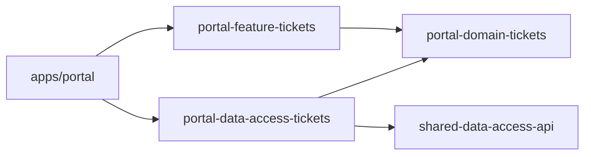

# ADR-0002: Màn hình phiếu yêu cầu gọi dữ liệu qua TicketPort

- **Trạng thái:** Đã chấp nhận
- **Ngày:** <ngày học buổi 1>
- **Người quyết định:** <nhóm>

## Bối cảnh

`TicketListPage` inject trực tiếp `TicketApi` (HttpClient) và đọc `content`, `totalElements` của Spring Page.
Hệ quả quan sát được:
- Muốn test màn hình phải dựng `HttpTestingController` và giả lập đúng JSON của backend.
- Đổi hình dạng response (ví dụ backend chuyển sang cursor paging) phải sửa cả component.
- Không có gì ngăn feature khác gọi `HttpClient` trực tiếp.

## Các phương án đã xem xét

| Phương án | Ưu điểm | Nhược điểm |
|---|---|---|
| Giữ nguyên, mock `TicketApi` bằng `vi.fn()` | Không phải thêm lib | Test vẫn gắn với hình dạng JSON; không có ranh giới được kiểm tra |
| Facade service trong feature lib | Ít file | Adapter HTTP vẫn nằm cùng UI; data-access không thể phụ thuộc vào hợp đồng nằm trong feature |
| **Port trong lib `type:domain`, adapter HTTP trong lib `type:data-access`, app chọn adapter** | Chiều phụ thuộc hướng vào domain; thay adapter bằng fake mà không dựng HTTP; lint kiểm tra được | Thêm 2 lib và một lớp chuyển đổi DTO → domain |

## Quyết định

- `@care/portal-domain-tickets` (`type:domain`): `TicketPort`, `TicketSummary`, `TicketQuery`, `TicketPage`. Không import Angular.
- `@care/portal-data-access-tickets` (`type:data-access`): `HttpTicketAdapter` gọi `TicketApi`, chuyển Spring Page → `TicketPage`.
- Route `tickets` trong `apps/portal` (composition root) gọi `provideHttpTicketPort()`.
- Test dùng `InMemoryTicketAdapter` từ `@care/portal-domain-tickets/testing`.

## Hệ quả

- **Tốt:** test màn hình chạy không cần HTTP (`ticket-list.page.spec.ts`); đổi backend chỉ sửa adapter.
- **Phải chấp nhận:** khi thêm thao tác (tạo, duyệt phiếu ở buổi 2) phải bổ sung vào port và cả hai adapter.
- **Cách kiểm chứng:** ESLint chặn `type:feature` import `@angular/common/http`, chặn `feature-tickets` import `TicketApi`,
  chặn `type:domain` import Angular; CI chạy `nx run-many -t lint` cho mỗi push.

## Khi nào xem lại

Nếu số feature dùng port tăng mà port chỉ còn là lớp chuyển tiếp không có chuyển đổi nào, cân nhắc gộp lại.
