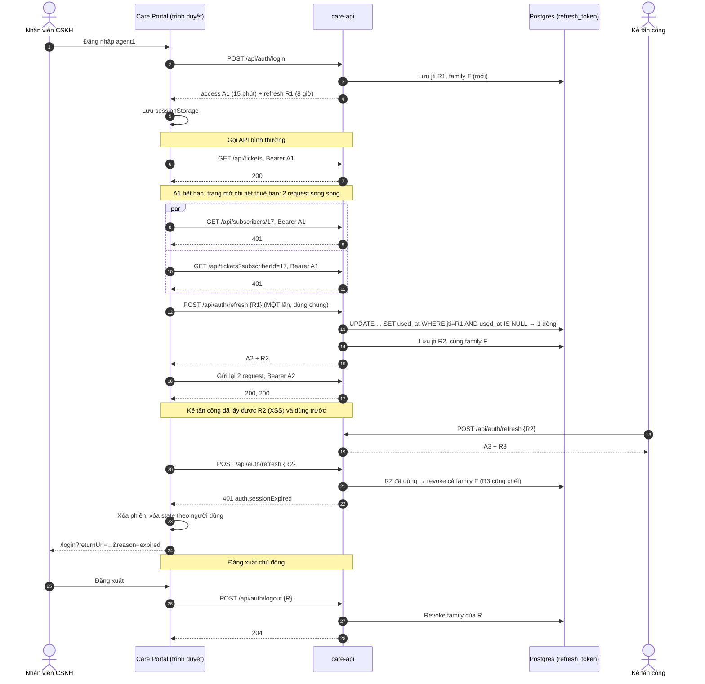

# Vòng đời phiên đăng nhập của Care Portal

Bản hiện tại (nhánh `session06-end`): backend tự phát JWT HS256; access token ngắn hạn, refresh token rotation có trạng thái;
frontend lưu cả hai trong `sessionStorage`. Buổi 7 thêm chế độ SSO (Keycloak) nhưng giữ cùng vòng đời.

## 1. Các loại token

| | Access token | Refresh token |
|---|---|---|
| Dùng để | Gọi API (`Authorization: Bearer`) | Đổi lấy cặp token mới, chỉ gửi tới `/api/auth/refresh` và `/api/auth/logout` |
| Thời hạn | `ACCESS_TOKEN_TTL`, mặc định 15 phút (lớp học: 30 giây) | `REFRESH_TOKEN_TTL`, mặc định 8 giờ (một ca làm việc) |
| Server kiểm tra | Signature HS256, `exp` (clock skew tối đa 10 giây), `iss`, `aud`, `token_use=access` | Như access, thêm: `jti` có trong bảng `refresh_token`, chưa dùng, chưa revoke |
| Có trạng thái ở server | Không: không revoke được trước khi hết hạn | Có: mỗi lần dùng được đánh dấu, cả family revoke được |
| Frontend đọc | Payload (tên, `roles`) để hiển thị; **không** dùng để quyết định quyền | Không đọc, chỉ gửi đi |

## 2. Sơ đồ trình tự

## 3. Quy tắc ở frontend

| Tình huống | Hành vi | Code |
|---|---|---|
| Request tới API của mình | Gắn Bearer. "Của mình" = **cùng origin** và nằm dưới đường dẫn của `apiUrl` | `api-url.ts` (`apiPathOf`) |
| Request tới domain khác, `/api/auth/*` | Không gắn Bearer | `auth.interceptor.ts` |
| 401 khi đã gửi token | Refresh **dùng chung** (một request cho mọi 401 đang chờ), gửi lại request **một lần** | `AuthService.refresh` (`share` + `finalize`) |
| 401 về muộn (token đã được thay) | Không refresh, gửi lại bằng token hiện tại | `auth.interceptor.ts` |
| Refresh trả 401 | Đăng xuất **một lần** trong phần dùng chung, giữ `returnUrl`, `reason=expired` | `AuthService.refresh` |
| Refresh lỗi mạng (status 0, 5xx) | Giữ phiên, báo lỗi request; lần sau thử lại | `AuthService.refresh` |
| Người dùng đăng xuất | Gọi `/api/auth/logout` (không chờ), xóa phiên ngay; state root theo người dùng tự xóa khi `username` đổi | `AuthService.logout`, `RecentSubscribers` (buổi 4) |
| F5 | Khôi phục từ sessionStorage nếu **refresh token** còn hạn (access hết hạn thì refresh khi gọi API) | `AuthService.init` |

## 4. Nơi lưu token: so sánh

| | Bộ nhớ JS (biến) | `sessionStorage` (hiện tại) | `localStorage` | Cookie `HttpOnly; Secure; SameSite` |
|---|---|---|---|---|
| JS đọc được (XSS lấy được token) | Có, khi script chạy trong trang | Có | Có | **Không** |
| Còn sau F5 | Không (phải refresh bằng cách khác) | Có | Có | Có |
| Chia sẻ giữa các tab | Không | Không (mỗi tab một phiên) | Có | Có |
| Trình duyệt tự gửi kèm (rủi ro CSRF) | Không | Không | Không | **Có** → cần `SameSite` + CSRF token |
| Gửi được sang API khác domain | Có (tự gắn header) | Có | Có | Chỉ khi cookie thuộc domain API, CORS `allowCredentials` |
| Hợp với | SPA + BFF | Ứng dụng nội bộ, phiên theo tab | Ít khi nên dùng cho token | Cùng site với API, hoặc mô hình BFF |

**XSS và CSRF đổi chỗ cho nhau.** Token trong storage: XSS là đủ để lấy token mang đi dùng ở máy khác. Cookie `HttpOnly`: XSS không lấy
được token (nhưng vẫn gọi API được ngay trong trang bị nhiễm), đổi lại trình duyệt tự gửi cookie, nên phải chống CSRF:

- `SameSite=Lax` hoặc `Strict` chặn phần lớn request chéo site.
- CSRF token kiểu *double submit*: server đặt cookie `XSRF-TOKEN` (JS đọc được), client gửi lại trong header `X-XSRF-TOKEN`.
  Angular `HttpClient` làm sẵn (`withXsrfConfiguration`), nhưng **chỉ cho URL tương đối** (cùng origin); Spring Security có
  `CookieCsrfTokenRepository`.
- Không dùng `GET` để thay đổi dữ liệu.

**Phương án cho Care Portal nếu đưa ra Internet:** BFF (Backend for Frontend) cùng origin với SPA, giữ refresh token phía server,
trình duyệt chỉ có cookie phiên `HttpOnly; Secure; SameSite=Strict`, kèm CSRF token. Hiện tại (mạng nội bộ, phiên theo tab) giữ
`sessionStorage` + TTL ngắn + phát hiện reuse + CSP. Ghi lại thành ADR khi quyết định.

## 5. Những điều không thay đổi dù lưu ở đâu

- **Server quyết định quyền.** Ẩn nút chỉ là trải nghiệm; API trả 403 (ma trận dòng 9).
- **HTTPS bắt buộc** ở mọi môi trường thật: Bearer và cookie đi dạng rõ trên HTTP. Buổi 9 bật HSTS ở nginx.
- **Không có secretKey trong code client.** Signing key của JWT, client secret chỉ ở server/biến môi trường.
- **CORS không phải phân quyền.** CORS chỉ quyết định trang web nào được *đọc* response trong trình duyệt; curl không bị CORS
  (ma trận dòng 18).
